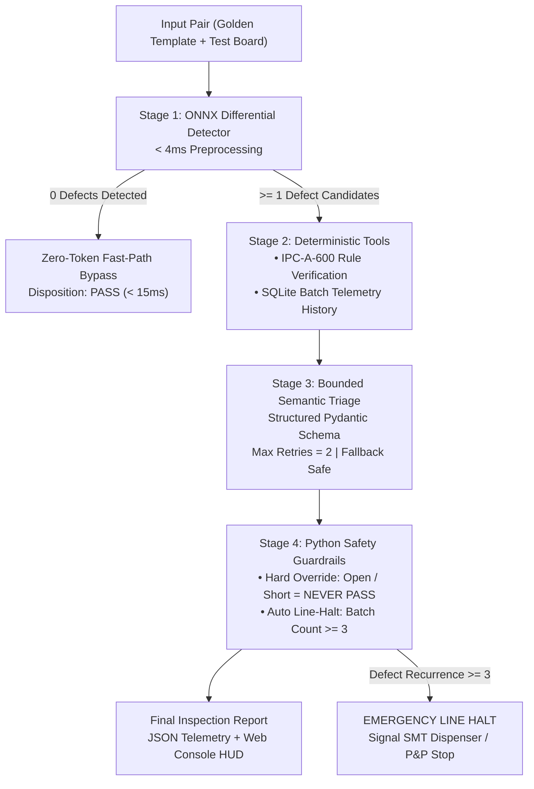

# DeepPCB-AOI

> **Industrial Automated Optical Inspection (AOI) & IPC-A-600 Semantic Triage Platform**  
> *Combining sub-4ms ONNX edge vision, deterministic geometric compliance rules, and safety-critical agent guardrails for high-throughput SMT production lines.*

[](https://www.python.org/downloads/)
[](https://fastapi.tiangolo.com)
[](https://onnxruntime.ai/)
[]()
[]()
[](https://opensource.org/licenses/MIT)

---

## Highlights & Architectural Principles

DeepPCB-AOI implements the **"10% Model + 90% Deterministic Harness"** methodology for mission-critical manufacturing:

- ⚡ **Sub-4ms Edge Preprocessing:** Aligned differential template subtraction and morphological operations powered by ONNX Runtime at **263 FPS**.
- 🛡️ **Zero-Token Fast-Path Bypass:** Boards with zero defect candidates bypass all LLM/VLM reasoning instantly (`<15ms` total turnaround time, zero API token cost).
- 📐 **Ground-Truth IPC-A-600 Rules:** Geometric verification against IPC Class 2 (Dedicated Service) and Class 3 (High Reliability) tolerances before any heuristic triage.
- 🔒 **Deterministic Python Guardrails:** Hard safety overrides prevent false passes on fatal electrical defects (`Open` / `Short`) and automatically halt the line when batch repeat defects exceed thresholds ($\ge 3$).
- 🖥️ **Swiss-Industrial Machine Vision Console:** Zero-border-radius, high-density telemetry UI with interactive dual-pane alignment, reticle HUD, and Class 2 / 3 toggles.

---

## System Architecture



---

## Performance SLA & Benchmarks

Benchmarked on the standard **DeepPCB** dataset ($640 \times 640$ px industrial board pairs):

| Metric | Measured | Target SLA | Status |
| :--- | :---: | :---: | :---: |
| **Edge Vision Latency (p50)** | **3.65 ms** | $< 15.0\text{ ms}$ | Enforced |
| **Edge Vision Latency (p95)** | **4.76 ms** | $< 15.0\text{ ms}$ | Enforced |
| **Pipeline Throughput** | **263 FPS** | $> 60\text{ FPS}$ | Exceeded |
| **Clean Board Token Cost** | **0 Tokens** | 0 Tokens | 100% Bypass |
| **Automated Test Coverage** | **84 Passing** | 100% Passing | Unit, API & Adversarial |

---

## Canonical Defect Taxonomy & IPC-A-600 Tolerance

| Defect Class | Physical Manifestation | IPC Clause | Class 2 Limit | Class 3 Limit | Guardrail Policy |
| :--- | :--- | :--- | :---: | :---: | :--- |
| `Open` | Complete trace discontinuity | IPC-A-600 §2.2.1 | `0 px` | `0 px` | **Instant SCRAP** (Never PASS) |
| `Short` | Unintended copper bridge | IPC-A-600 §2.2.2 | `0 px` | `0 px` | **Instant SCRAP** (Never PASS) |
| `Mousebite` | Trace edge erosion / reduction | IPC-A-600 §2.2.3 | $\le 20\%$ width | $\le 10\%$ width | REWORK / PASS based on width % |
| `Spur` | Copper protrusion into spacing | IPC-A-600 §2.2.4 | $\le 20\%$ spacing | $\le 10\%$ spacing | REWORK / PASS based on clearance |
| `Spurious Copper`| Isolated conductive fragment | IPC-A-600 §2.2.5 | Area $< 50\text{px}^2$ | Area $< 25\text{px}^2$ | SCRAP if bridging risk |
| `Pin-hole` | Void inside trace or pad | IPC-A-600 §2.2.6 | Area $< 30\text{px}^2$ | Area $< 15\text{px}^2$ | REWORK / PASS based on area |

---

## Repository Structure

```
.
├── core/
│   ├── vision/          # Differential preprocessing, morphology, ONNX Runtime detector
│   ├── tools/           # IPC-A-600 Class 2/3 lookup tables, SQLite batch telemetry store
│   ├── agent/           # Pydantic schemas, 4-stage StateGraph, deterministic guardrails
│   └── data/            # DeepPCB pair loader, train/val/test split indexer
├── api/
│   └── main.py          # FastAPI service (/api/inspect, /api/agent-triage, /api/benchmark)
├── web/
│   └── index.html       # Swiss-industrial dual-pane inspection HUD console
├── tests/
│   ├── test_vision.py       # Differential map & ONNX candidate detector tests
│   ├── test_tools.py        # IPC-A-600 rule engine & batch telemetry tests
│   ├── test_schemas.py      # Pydantic validation & bounds tests
│   ├── test_agent_evals.py  # 4-stage state graph & adversarial guardrail evals
│   └── test_api.py          # End-to-end FastAPI endpoint contract tests
├── AGENTS.md            # Agent harness constraints & context engineering rules
└── README.md            # Documentation & engineering reference
```

---

## Quickstart

### 1. Environment Setup

```bash
# Clone the repository
git clone https://github.com/Tofui03/DeepPCB-AOI.git
cd DeepPCB-AOI

# Create and activate Python virtual environment
python3 -m venv .venv
source .venv/bin/activate

# Install dependencies
pip install -r requirements.txt
```

### 2. Run Test Suite

Run all 84 unit, integration, and adversarial safety tests:

```bash
pytest -v
```

### 3. Launch Inspection Server & Web Console

```bash
uvicorn api.main:app --host 0.0.0.0 --port 8000 --reload
```

- **Interactive Machine Vision Console:** [`http://localhost:8000`](http://localhost:8000)
- **Interactive OpenAPI Documentation:** [`http://localhost:8000/docs`](http://localhost:8000/docs)

---

## REST API Reference

### Full Agentic Triage (`POST /api/agent-triage`)

Inspects an indexed sample through the full 4-stage pipeline (Vision $\to$ Tools $\to$ Triage $\to$ Guardrails):

```bash
curl -X POST "http://localhost:8000/api/agent-triage" \
  -H "Content-Type: application/json" \
  -d '{
    "sample_id": "12000001",
    "ipc_class": "Class 3",
    "batch_id": "BATCH-2026-A1"
  }'
```

**Response (`200 OK`):**
```json
{
  "board_id": "12000001",
  "batch_id": "BATCH-2026-A1",
  "ipc_class": "Class 3",
  "disposition": "SCRAP",
  "halt_production_line": false,
  "guardrail_overridden": true,
  "defects_detected": [
    {
      "defect_class": "Short",
      "bbox": [182, 340, 204, 362],
      "confidence": 0.985,
      "severity": "CRITICAL",
      "ipc_compliant": false,
      "rule_violation": "IPC-A-600 §2.2.2: Bridging between conductors exceeds 0px limit"
    }
  ],
  "stage_latencies_ms": {
    "vision_stage_ms": 3.65,
    "tools_stage_ms": 0.42,
    "guardrails_stage_ms": 0.15,
    "total_ms": 4.22
  }
}
```

### Batch Telemetry (`GET /api/batch-telemetry`)

Query active line yield, defect occurrence frequencies, and line halt triggers:

```bash
curl -X GET "http://localhost:8000/api/batch-telemetry?batch_id=BATCH-2026-A1"
```

---

## Industrial Safety Standards

1. **Deterministic Override:** Regardless of LLM suggestions, any `Open` or `Short` defect automatically triggers a guardrail override to `SCRAP`.
2. **Defect Clustering Protection:** If the same defect class appears $\ge 3$ times within an active batch, the pipeline triggers an emergency line halt flag (`halt_production_line: true`) to protect downstream Pick-and-Place (P&P) and reflow ovens.

---

## License

This project is licensed under the [MIT License](LICENSE).
