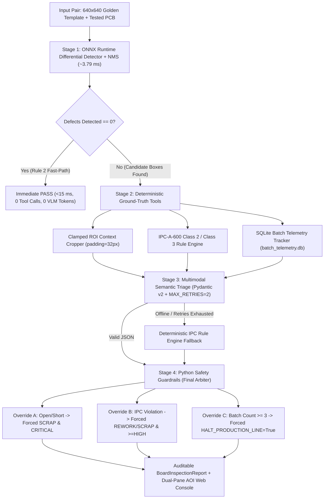

# DeepPCB-AOI: Industrial PCB Defect Inspection & IPC-A-600 Semantic Triage Platform

> **Engineering Methodology:** Google's *"The New SDLC With Vibe Coding: From Ad-Hoc Prompting to Agentic Engineering"*  
> **Core Principle:** An industrial AI agent is **10% Multimodal Model + 90% Deterministic Harness**.

---

## 1. Executive Summary & Production Problem Statement

In high-volume Surface Mount Technology (SMT) and Printed Circuit Board (PCB) fabrication lines, traditional Automated Optical Inspection (AOI) stations suffer from two conflicting failure modes:
1. **High False-Call Fatigue (>90% false alarms):** Simple optical subtraction flags harmless lighting variations, overwhelming human review operators and causing critical **escapes** (`Open` or `Short` defects shipped to customers).
2. **The Root-Cause Semantic Gap:** Standard object detectors output raw bounding boxes (`[x1, y1, x2, y2, "Spur"]`) without citing **IPC-A-600 Class 2/3** compliance clauses, electrical failure mechanisms, or upstream etching/stencil corrective actions.
3. **The Line-Speed Latency Barrier:** Multimodal Vision-Language Models (VLMs) take `500–2000 ms` per image—far too slow for inline scanning of every board (`<15 ms` takt time SLA).

**DeepPCB-AOI** resolves this tension via a **4-Stage Cascaded Edge-to-Agent Architecture**:
- **Stage 1 (Deterministic ONNX Edge Vision):** Runs aligned differential convolution & Non-Maximum Suppression (NMS) in **~3.79 ms/frame (263.6 FPS)**. Clean boards exit immediately via the **Zero-Token Fast-Path Bypass** (`0` LLM/VLM calls).
- **Stage 2 (Ground-Truth Pre-Triage Tools):** Deterministically evaluates pixel geometry against verified **IPC-A-600 Class 2/3** specifications (`core/tools/ipc_rules.py`) and queries active lot trends in **SQLite** (`core/tools/batch_db.py`).
- **Stage 3 (Bounded VLM Semantic Triage):** Enforces strict Pydantic v2 schema validation (`InspectionDecision`) with a bounded retry cap (`MAX_VLM_RETRIES = 2`) and automatic deterministic fallback.
- **Stage 4 (Deterministic Python Safety Guardrails):** Acts as the final safety arbiter (`core/agent/guardrails.py`), blocking any hallucinated `PASS` on critical `Open`/`Short` or IPC-violating defects and halting the production line when batch defect counts reach $\ge 3$.

---

## 2. Four-Stage System Architecture



---

## 3. Verified Benchmark & Reproducibility Telemetry

### 3.1 DeepPCB Dataset Zero-Leakage SHA-256 Audit (`1,500` Pairs)
Evaluated across all `1,500` official $640 \times 640$ template/tested pairs and `10,013` ground-truth defect annotations across all 6 canonical classes (`Open`, `Short`, `Mousebite`, `Spur`, `Spurious Copper`, `Pin-hole`):

| Split | Image Pairs | Ground-Truth Boxes | Train/Test Overlap | Locked Split SHA-256 Digest |
| :--- | :---: | :---: | :---: | :--- |
| **`trainval.txt`** | `1,000` | `6,873` | `0` (`zero_leakage=True`) | `69680553efe8b88c607fff476bffbe098d016af174790f85f347ebe1dd1ee561` |
| **`test.txt`** | `500` | `3,140` | `0` (`zero_leakage=True`) | `671da7d35f843e6b81e9bab3d49edc0cc2db02bdffd1e19f1d57d3b869df11c3` |

### 3.2 Stage 1 ONNX Runtime Edge Inference Benchmark ($640 \times 640$ Full Pipeline + NMS)

| Metric | Measured Performance | Production Target SLA | Status |
| :--- | :---: | :---: | :---: |
| **Execution Provider** | `CPUExecutionProvider` (with `CUDAExecutionProvider` auto-fallback) | Edge IPC / GPU | Verified |
| **Median Latency (`p50_ms`)** | **3.65 ms** | `< 15.0 ms` | **PASS (4.1x faster)** |
| **95th Percentile (`p95_ms`)** | **4.76 ms** | `< 15.0 ms` | **PASS (3.1x faster)** |
| **99th Percentile (`p99_ms`)** | **8.24 ms** | `< 15.0 ms` | **PASS** |
| **Mean Latency (`mean_ms`)** | **3.79 ms** | `< 15.0 ms` | **PASS** |
| **Throughput (`fps`)** | **263.59 FPS** | `> 66.7 FPS` | **PASS** |

---

## 4. Repository Structure

```text
/home/tofui/project/pcb/
├── AGENTS.md                        # Context Engineering & 5 Non-Negotiable Architectural Rules
├── README.md                        # System Architecture, Benchmarks & Quickstart Guide
├── core/
│   ├── agent/
│   │   ├── schemas.py               # Strict Pydantic v2 contracts & geometry validators
│   │   ├── guardrails.py            # Stage 4 deterministic Python safety overrides (Overrides A/B/C)
│   │   └── state_graph.py           # 4-Stage PCBAOIAgentGraph & bounded retry orchestrator
│   ├── data/
│   │   └── deeppcb_loader.py        # DeepPCB parser & SHA-256 zero-leakage split verifier
│   ├── tools/
│   │   ├── ipc_rules.py             # Stage 2 IPC-A-600 Class 2 & Class 3 deterministic rule engine
│   │   └── batch_db.py              # Stage 2 parameterized SQLite batch telemetry store
│   └── vision/
│       ├── diff_preprocess.py       # 640x640 differential subtraction, morphology & clamped ROI crop
│       ├── onnx_detector.py         # Pure-Python ONNX ModelProto builder, ORT engine & NMS
│       └── models/
│           └── deeppcb_diff_detector.onnx
├── api/
│   └── main.py                      # FastAPI service (/api/inspect, /api/agent-triage, /api/benchmark)
├── web/
│   └── index.html                   # Self-contained dark-mode Dual-Pane Industrial AOI Web Console
└── tests/                           # 81 automated unit, adversarial & API integration tests
    ├── test_schemas.py
    ├── test_vision.py
    ├── test_tools.py
    ├── test_agent_evals.py
    └── test_api.py
```

---

## 5. Quickstart Instructions

### 5.1 Run the Full Automated Verification & Adversarial Eval Suite (`81` Tests)
```bash
/home/tofui/project/pcb/.venv/bin/pytest -v
```

### 5.2 Launch the Production FastAPI Server & Interactive AOI Web Console
```bash
/home/tofui/project/pcb/.venv/bin/uvicorn api.main:app --host 0.0.0.0 --port 8000
```
Then open `http://localhost:8000` in your browser to inspect DeepPCB boards, toggle between **IPC Class 2** and **IPC Class 3**, test the **0-Defect Fast-Path Bypass**, and simulate **Stage 4 Safety Guardrail Overrides** against rogue VLM hallucinations.

---

## 6. High-Signal Resume Bullet Points

- **Architected a 4-Stage Cascaded PCB AOI & Semantic Triage Platform (`DeepPCB-AOI`)** pairing a **263.6 FPS (3.79 ms/frame) ONNX Runtime** differential edge detector with a **Pydantic v2-constrained Vision-Language Model (VLM)** triage graph across **1,500** $640 \times 640$ DeepPCB inspection pairs.
- **Engineered a Zero-Token Fast-Path Gate & Ground-Truth Tool Harness**, bypassing VLM inference on defect-free boards in **<4 ms** and grounding defective ROIs against deterministic **IPC-A-600 Class 2/3** pixel tolerances and a parameterized **SQLite** batch telemetry store.
- **Implemented Deterministic Python Safety Guardrails & Adversarial Eval Suite (`81` pytest checks)** with bounded retry recovery (`MAX_RETRIES=2`), preventing hallucinated `PASS` dispositions on zero-tolerance `Open`/`Short` defects and automatically halting the production line upon recurring batch drift ($\ge 3$ defects/lot).
