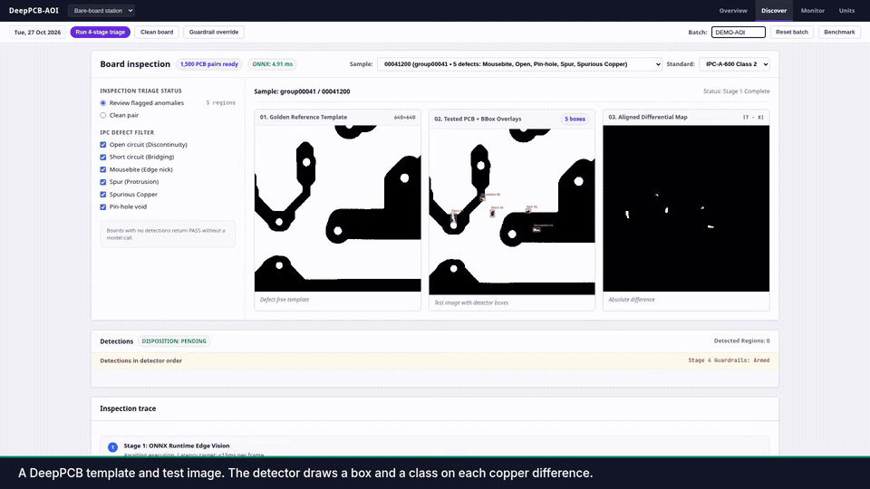
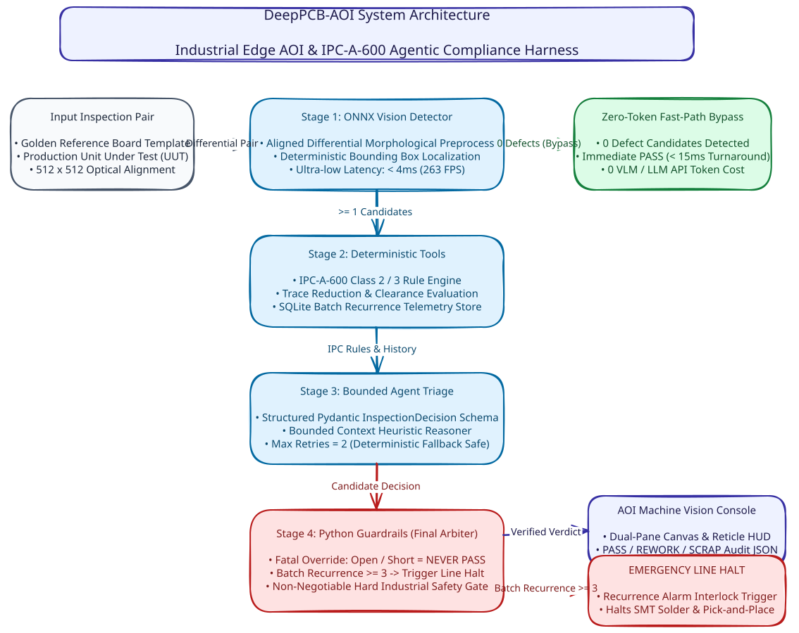
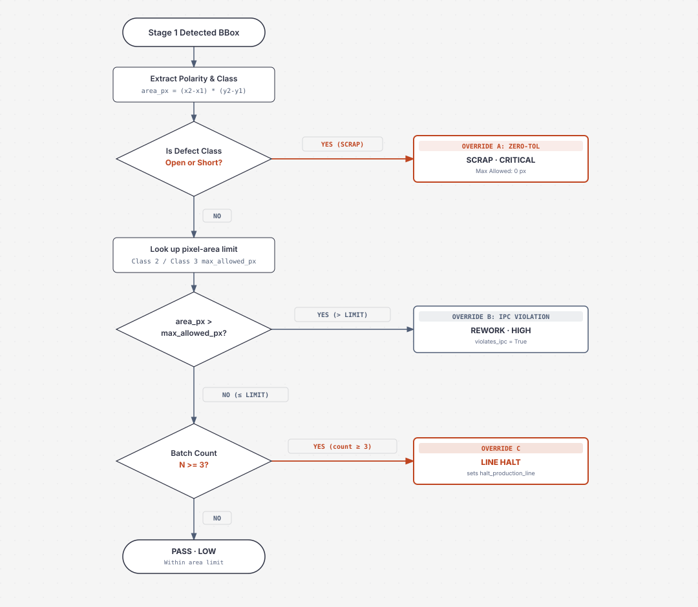

# DeepPCB-AOI

DeepPCB-AOI compares a template image with a test image for bare-board inspection of the six defect classes in the [DeepPCB](https://github.com/tangsanli5201/DeepPCB) dataset (Tang, He, Huang, and Yang, 2019). An ONNX Runtime detector proposes boxes, pixel-area rules check each box, a short rule set can override the disposition, and a FastAPI app serves a web console.

Supports two selectable Stage 1 detector backends:
1. **`ONNXPCBDetector` (Default)**: Lightweight 696-byte hand-crafted differential baseline (`mean < 1ms` on CPU).
2. **`YOLOv8PCBDetector`**: Learned 3-channel composite model (`[template, test, absdiff]`) reaching **0.9401 F1** (0.9828 Recall, 0.9010 Precision) on the official 500-pair held-out test set. Set `DETECTOR_BACKEND=yolov8` to activate.



## Detection Benchmarks & Ablation Study

Evaluated on the official held-out DeepPCB test set (500 pairs, 3,140 ground-truth defect instances) under the standard IoU=0.33 (Tang et al. 2019) and IoU=0.50 benchmarks:

| Method | Input Format | Precision (IoU=0.33) | Recall (IoU=0.33) | F1 (IoU=0.33) | Precision (IoU=0.50) | Recall (IoU=0.50) | F1 (IoU=0.50) | Mean Latency |
| --- | --- | ---: | ---: | ---: | ---: | ---: | ---: | ---: |
| **A: Differential ONNX Baseline** | Dual `template`, `test` | 0.0119 | 0.0914 | 0.0211 | 0.0046 | 0.0350 | 0.0081 | 3.16 ms (GPU) / 0.79 ms (CPU) |
| **B: YOLOv8n Single Image** | Single `<id>_test.jpg` | 0.8703 | 0.9723 | 0.9185 | 0.8677 | 0.9694 | 0.9158 | 10.38 ms (GPU) / 24.72 ms (CPU) |
| **C: YOLOv8n 3-Channel Composite** | 3-Ch `[template, test, absdiff]` | **0.9010** | **0.9828** | **0.9401** | **0.8999** | **0.9815** | **0.9389** | **9.98 ms (GPU)** / 22.15 ms (CPU) |

### Per-Class F1 Breakdown (IoU = 0.33)

| Defect Class | Ground Truth Count | Method A (Heuristic Diff) | Method B (Single Image) | Method C (3-Channel Composite) | Key Improvement Note |
| --- | ---: | ---: | ---: | ---: | --- |
| **Open** | 659 | 0.0170 | 0.9523 | **0.9335** | High recall (>98%) on circuit trace breaks |
| **Short** | 478 | 0.0135 | 0.8580 | **0.9273** | **+6.9% F1 over B**: template disambiguates layout traces from short bridges |
| **Mousebite** | 586 | 0.0826 | 0.9593 | **0.9312** | Reliable edge nick detection |
| **Spur** | 483 | 0.0745 | 0.9308 | **0.9294** | Robust against copper trace protrusions |
| **Spurious Copper** | 464 | 0.0000 | 0.9488 | **0.9625** | Method A is completely blind (0.0 F1); C achieves 99.6% recall |
| **Pin-hole** | 470 | 0.0023 | 0.8507 | **0.9631** | **+11.2% F1 over B**: template prevents normal drill vias from triggering false alarms |

### Why Method C Wins: Failure Mode Analysis
1. **Short defects without template reference**: In Method B (single image), the model achieves only 0.8580 F1 on `Short` defects because normal trace proximity can look identical to a copper bridge without the template reference. Method C leverages Channel 0 to check intended connectivity, boosting Short F1 to 0.9273.
2. **Pin-holes vs Normal Vias/Pads**: In single-image mode, isolated dark circular pads are frequently misclassified as pin-holes (Method B precision on Pin-hole is only 74.0%). In Method C, because the template board explicitly shows normal pads, Pin-hole precision jumps to 92.9% and F1 reaches 0.9631.
3. **Traditional Heuristic Failure**: Method A generates 23,760 False Positives on 500 test images (~47 FP/image) due to sub-pixel registration jitter along high-contrast copper trace edges.

Visualized failure samples and bounding box overlays are archived under `docs/bad_cases/method_a`, `docs/bad_cases/method_b`, and `docs/bad_cases/method_c`.

## Quick start

Python 3.10 or newer.

```bash
python3 -m venv .venv
source .venv/bin/activate
pip install -r requirements.txt
git clone --depth 1 https://github.com/tangsanli5201/DeepPCB.git data/DeepPCB
uvicorn api.main:app --host 0.0.0.0 --port 8000
```

Open `http://localhost:8000/`.

```bash
pytest
```

Tests run without the dataset via a small fixture in `core/data/mock_pcb`, used only when `data/DeepPCB/PCBData` is absent.

## Results

| Metric | Value |
| --- | --- |
| Stage 1 mean latency | ~0.79 ms on an Intel Xeon CPU (synthetic 640×640 pair) |
| Stage 1 test gate | 15 ms mean |
| Defect classes | 6 |
| Tests | 87 passing |

## How it works

1. **Detect.** `core/vision` runs the ONNX difference graph on 640×640 inputs, groups high-scoring cells into boxes, labels each box from the sign of `template - test` plus area, aspect ratio, and fill, and drops overlaps; no boxes means `disposition = PASS` and stages 2–4 do not run. Alternatively, `YOLOv8PCBDetector` (`DETECTOR_BACKEND=yolov8`) runs the learned 3-channel composite network.
2. **Rules and batch history.** `core/tools` checks each box against a pixel-area limit and increments a SQLite count for `(batch_id, defect_class)`.
3. **Optional model triage.** A configured callable must return a valid `InspectionDecision` or the rule engine is used; the default server calls no external model, and the callable does not edit box coordinates.
4. **Overrides.** `core/agent/guardrails.py` blocks PASS for Open, Short, and an over-limit box, and sets `halt_production_line` on the third occurrence of the same class in a batch.



One detected box takes the path below.



## Defect classes

| Class | What it is on the copper |
| --- | --- |
| Open | Break in a trace |
| Short | Copper bridge between traces |
| Mousebite | Nick in the trace edge |
| Spur | Sharp copper protrusion |
| Spurious Copper | Isolated copper speck |
| Pin-hole | Small void in copper |

DeepPCB labels use ids 1–6 in that order. Images are 640×640.

## Limitations

- Class labels in the default difference baseline come from a geometry heuristic. The YOLOv8 backend (`DETECTOR_BACKEND=yolov8`) provides a learned 0.9401 F1 detector.
- Pixel-area limits stand in for an IPC-A-600 table. The check does not measure conductor width or spacing.
- No external model is configured by default.

Implementation details: [docs/DETAILS.md](docs/DETAILS.md).
