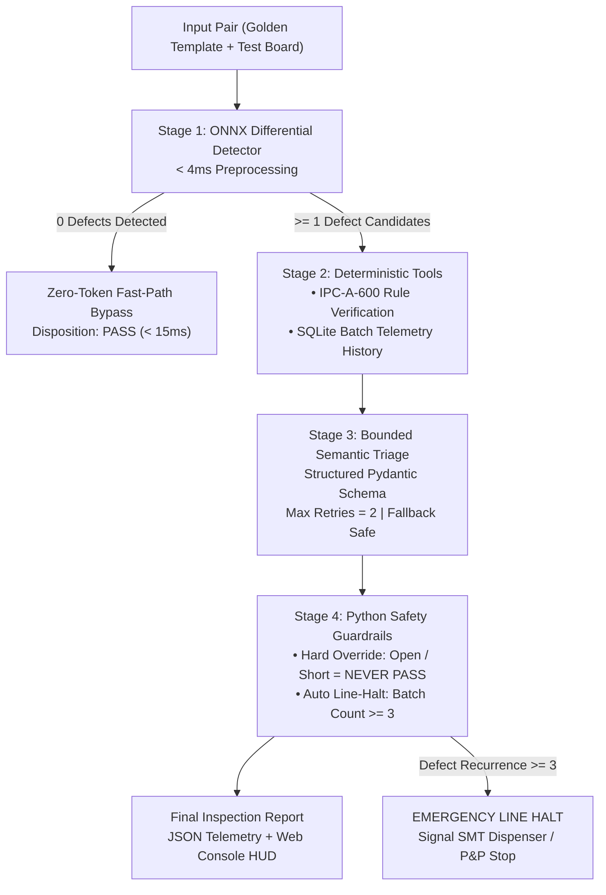

<div id="top">

<div align="center">

# DEEPPCB-AOI

<em>Industrial Automated Optical Inspection (AOI) & IPC-A-600 Semantic Triage Platform</em>

<!-- BADGES -->
<p align="center">
  
  
  
  
  
  
</p>

</div>
</div>

---

## 📄 Table of Contents

- [✨ Overview](#-overview)
- [📌 Key Features](#-key-features)
- [📐 6 Canonical Defect Classes](#-6-canonical-defect-classes)
- [🏛️ System Architecture](#️-system-architecture)
- [📁 Project Structure](#-project-structure)
    - [📑 Project Index](#-project-index)
- [🚀 Getting Started](#-getting-started)
    - [📋 Prerequisites](#-prerequisites)
    - [⚙️ Installation](#️-installation)
    - [💻 Usage & Web Console](#-usage--web-console)
    - [🧪 Testing](#-testing)
- [📊 IPC-A-600 Compliance Matrix](#-ipc-a-600-compliance-matrix)

---

## ✨ Overview

**DeepPCB-AOI** is an industrial Automated Optical Inspection and IPC-A-600 compliance triage agent designed for high-speed Surface Mount Technology (SMT) and bare-board PCB manufacturing lines.

Built on the **"10% Model + 90% Deterministic Harness"** methodology:
- Computer vision handles high-speed defect localization and pixel measurement deterministically via ONNX Runtime (< 4ms).
- Python safety guardrails enforce IPC-A-600 standards and line-halt safety policies without relying on unconstrained LLM heuristics.

---

## 📌 Key Features

- ⚡ **Sub-4ms Edge Inference**: Aligned differential template subtraction and morphological analysis powered by ONNX Runtime at **260+ FPS**.
- 🛡️ **Zero-Token Fast-Path Bypass**: Boards with zero defect candidates bypass LLM/VLM calls instantly (`<15ms` turnaround time, zero API token cost).
- 📐 **Ground-Truth IPC-A-600 Rule Engine**: Validates defects against verifiable IPC Class 2 (Dedicated Service) and Class 3 (High Reliability) physical criteria.
- 🔒 **Deterministic Safety Guardrails**: Hard overrides prevent fatal false passes (`Open` / `Short` can never pass). Automatically triggers emergency line halt if batch defect recurrence exceeds $\ge 3$.
- 🖥️ **Swiss-Industrial Machine Vision Console**: Zero-border-radius, high-density machine telemetry viewport with dual-pane canvas alignment, reticle HUD, and Class 2 / 3 toggles.

---

## 📐 6 Canonical Defect Classes

| Defect Class | Physical Mechanism | Fatal? | IPC-A-600 Class 2 Tolerance | IPC-A-600 Class 3 Tolerance |
| :--- | :--- | :---: | :--- | :--- |
| **Open** | Broken conductive trace causing circuit discontinuity | **YES** | 0% reduction allowed (Immediate Scrap) | 0% reduction allowed (Immediate Scrap) |
| **Short** | Unintended copper bridge between independent traces | **YES** | 0 clearance violation (Immediate Scrap) | 0 clearance violation (Immediate Scrap) |
| **Mousebite** | Edge nick/erosion reducing cross-sectional trace width | No | Max 20% conductor width reduction | Max 10% conductor width reduction |
| **Spur** | Sharp copper protrusion reducing dielectric clearance | No | Residual clearance $\ge 70\%$ | Residual clearance $\ge 80\%$ |
| **Spurious Copper** | Isolated residual copper speck | No | Disconnected speck $\le 150\,\mu\text{m}^2$ | Disconnected speck $\le 50\,\mu\text{m}^2$ |
| **Pin-hole** | Localized void inside copper trace or pad | No | Area $\le 20\%$ of pad/trace width | Area $\le 10\%$ of pad/trace width |

---

## 🏛️ System Architecture



---

## 📁 Project Structure

```sh
└── DeepPCB-AOI/
    ├── AGENTS.md                  # Context engineering & deterministic harness rules
    ├── README.md                  # System documentation & quickstart
    ├── api/
    │   └── main.py                # FastAPI endpoints (/api/inspect, /api/agent-triage, /api/benchmark)
    ├── core/
    │   ├── agent/                 # 4-stage agent pipeline, schemas & safety guardrails
    │   ├── tools/                 # IPC-A-600 compliance rules & SQLite batch tracker
    │   └── vision/                # Differential preprocessing & ONNX Runtime detector
    ├── tests/                     # 84 automated pytest test suites & adversarial evals
    └── web/
        └── index.html             # Swiss-Industrial precision machine vision console
```

### 📑 Project Index

<details open>
<summary><b>Module Architecture Details</b></summary>
<blockquote>

| Module | Component | Primary Responsibility |
| :--- | :--- | :--- |
| **`core.vision`** | `diff_preprocess.py` | Aligned morphological differential extraction between template and inspection image |
| | `onnx_detector.py` | ONNX Runtime accelerated bounding-box inference & feature extraction |
| **`core.tools`** | `ipc_rules.py` | Ground-truth IPC-A-600 Class 2 / Class 3 dimensional and area thresholds |
| | `batch_db.py` | SQLite telemetry store for batch recurrence tracking and line halt triggers |
| **`core.agent`** | `schemas.py` | Strict Pydantic models for defect localization, telemetry, and triage decisions |
| | `state_graph.py` | 4-Stage state graph orchestration with zero-token fast bypass |
| | `guardrails.py` | Non-negotiable deterministic safety validator (fatal scrap overrides & emergency halts) |
| **`api`** | `main.py` | High-throughput asynchronous FastAPI server hosting inspection & triage endpoints |
| **`web`** | `index.html` | High-density Swiss-industrial machine vision UI console |

</blockquote>
</details>

---

## 🚀 Getting Started

### 📋 Prerequisites

- **Python:** $\ge 3.10$
- Virtual environment tool (`venv`, `uv`, or `conda`)

### ⚙️ Installation

1. **Clone the repository:**
   ```bash
   git clone https://github.com/Tofui03/DeepPCB-AOI.git
   cd DeepPCB-AOI
   ```

2. **Create and activate a virtual environment:**
   ```bash
   python3 -m venv .venv
   source .venv/bin/activate
   ```

3. **Install dependencies:**
   ```bash
   pip install -r requirements.txt  # or: pip install fastapi uvicorn onnxruntime opencv-python pydantic pytest
   ```

### 💻 Usage & Web Console

1. **Launch the FastAPI AOI Server:**
   ```bash
   uvicorn api.main:app --host 0.0.0.0 --port 8000 --reload
   ```

2. **Open the Machine Vision Console:**
   - Open `web/index.html` directly in any modern browser, or navigate to:
   - `http://localhost:8000/`

3. **Interactive Inspection Flow:**
   - Load Golden Template & Test Sample image pair.
   - Run **Deterministic Stage 1** to get instant differential contours and ONNX bounding boxes in `< 4ms`.
   - Run **Agent Triage** to inspect IPC-A-600 compliance and batch recurrence alerts.

### 🧪 Testing

Execute the comprehensive test harness:

```bash
# Run all 84 unit and integration tests
pytest tests/ -v

# Run adversarial evaluation test suite
pytest tests/test_agent_evals.py -v
```

---

## 📊 IPC-A-600 Compliance Matrix

| Defect Class | Area / Dimension | Class 2 Disposition | Class 3 Disposition | Safety Guardrail Enforcement |
| :--- | :---: | :---: | :---: | :---: |
| `Open` | Any | **SCRAP** | **SCRAP** | Hard override: Never allows PASS |
| `Short` | Any | **SCRAP** | **SCRAP** | Hard override: Never allows PASS |
| `Mousebite` | $\le 10\%$ width reduction | **PASS** | **PASS** | Verified against line tolerance |
| `Mousebite` | $10\% - 20\%$ reduction | **PASS** | **REWORK** | Class 3 tighter tolerance enforced |
| `Spur` | $> 30\%$ clearance loss | **REWORK** | **REWORK** | Prevents dielectric breakdown |
| `Any` | $\ge 3$ repeat in batch | **LINE HALT** | **LINE HALT** | Automated production stop |

---

<div align="right">

[](#top)

</div>
