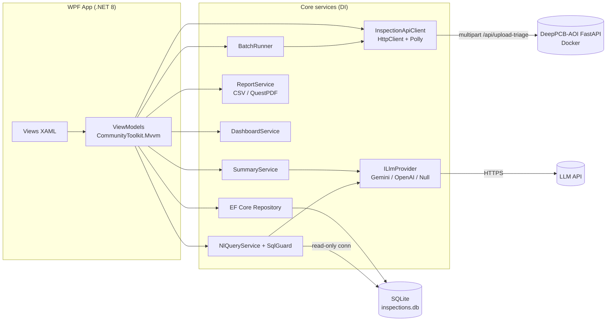
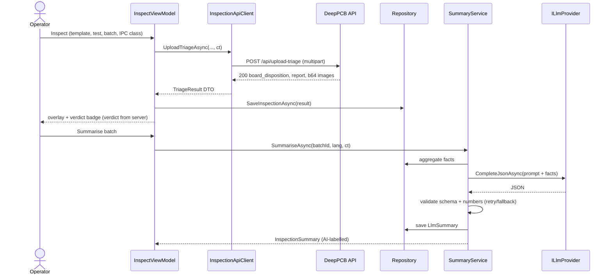
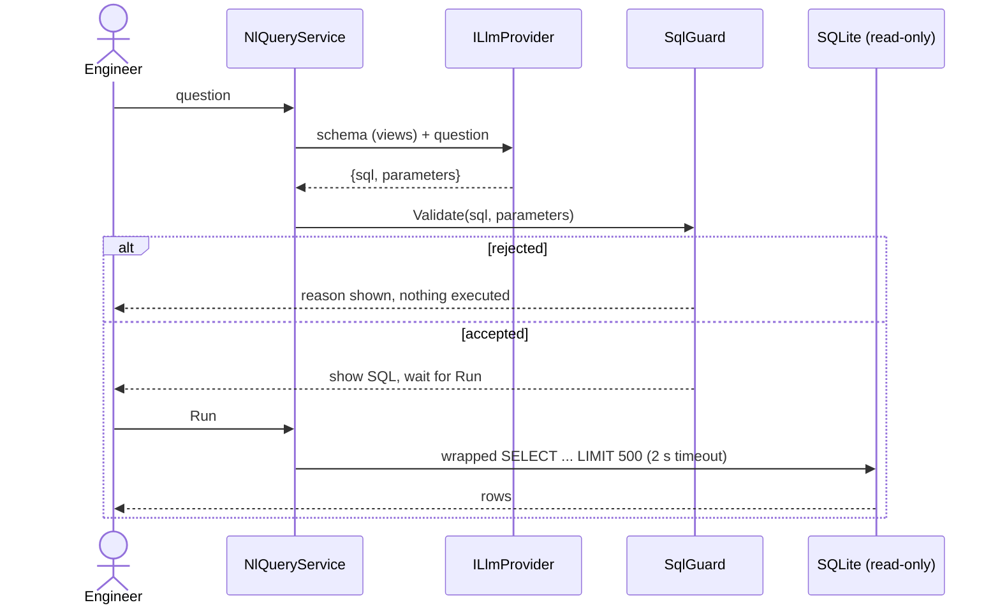

# PCB Inspection Viewer — Product Requirements & Technical Specification

**Owner:** Gwenfred Tham · **Version:** 1.0 (5 Nov 2026) · **Target repo:** `github.com/Tofui03/pcb-inspection-viewer` (new) · **Backend:** `github.com/Tofui03/DeepPCB-AOI` (existing, FastAPI v1.1.0)

---

## 0. 中文概览（给 Gwenfred）

**这是什么：** 一个用 C# WPF（.NET 8，MVVM）写的 Windows 桌面质检工具，作为你现有 DeepPCB-AOI FastAPI 后端的“产线操作员界面”。操作员选择 golden template 和待测图（单张或整个文件夹），程序调用 `/api/upload-triage`，在图上画出缺陷框，显示 PASS / REWORK / SCRAP，保存到本地 SQLite，并提供当日良率看板和 CSV/PDF 导出。

**为什么做：** 15 份目标 JD 里有 7 份要求 C#/.NET；槟城视觉检测公司（Greatech、Pentamaster、ViTrox、Intel、WD、Bosch）的产线软件大多是 Windows C#。Grab、Deriv 要求 LLM / agent 经验。这个项目一次覆盖 C#、CV、REST API、SQL、测试、CI/CD 和 LLM。

**LLM 功能（判定永远由规则决定，LLM 只解释和查询）：**
- **P1 必做**：LLM 生成批次质检总结（JSON schema 约束 + 校验，可选中英双语），没有 API key 或断网时退回模板生成的总结。
- **P2 应做**：自然语言查询历史记录 → SQL，只允许 SELECT、白名单表、限制行数，并把 SQL 显示给用户。
- **P3 可做**：基于你自己写的缺陷处理笔记做 RAG，并附引用。IPC-A-600 有版权，不复制原文。

**关键发现（来自读后端代码）：** 后端已有上传接口、6 类缺陷、PASS/REWORK/SCRAP 判定和 stage1 延迟字段，但**没有 Dockerfile、没有 health 接口，每条判定（decision）也没有直接关联到哪个检测框**。这些在第 9 节标为 “backend change required”。

**两周计划：** D1–3 学 C#/WPF + Docker 化后端；D4–7 单张检测 + 画框；D8–10 批量 + 表格 + SQLite；D11–12 看板 + 导出 + LLM 总结；D13–14 测试、CI、README，有时间再做自然语言查询。

---

## 1. Purpose and Rationale

### 1.1 Problem
DeepPCB-AOI is a strong model/API project (YOLOv8n 3-channel composite, F1 0.9401 on the 500-pair DeepPCB test set), but it ships only a browser console. Industrial AOI stations in Penang run **Windows desktop operator software written in C#/.NET**: an operator loads boards, sees defect overlays and a verdict, and the station keeps a local, traceable history. Gwenfred's portfolio has no C#/.NET evidence.

### 1.2 Evidence from target JDs
| Gap | Evidence | How this project closes it |
|---|---|---|
| C# / .NET / WPF | 7 of 15 target JDs (Intel, WD, Bosch, Greatech, Pentamaster, ViTrox-type vision roles) | Entire client is C# .NET 8 WPF |
| OOP / design patterns | Most SWE/test JDs | MVVM, DI, repository pattern, interfaces |
| SQL / database | Most data/test JDs | EF Core + SQLite history, NL→SQL |
| Automated testing, CI/CD | Most SWE/test JDs | xUnit, GitHub Actions on windows-latest |
| Docker / deployment | Cloud/MLOps asks | Dockerfile + docker-compose for the backend |
| LLM / agents | Grab, Deriv | Validated JSON summaries, guarded NL→SQL, optional RAG |

### 1.3 Goals
- G1. A working operator client against the real DeepPCB-AOI API, demo-able in under 2 minutes.
- G2. Code quality a senior C# reviewer would accept: MVVM, async with cancellation, DI, tests, CI.
- G3. LLM features that are safe by design: **verdicts stay deterministic and rule-based; the LLM only explains and queries.**
- G4. A README, demo GIF and resume bullet that tell one story: "AI model + production-line software".

### 1.4 Non-goals
See §13.

---

## 2. Grounding: What the Existing Backend Actually Provides

Read from `api/main.py`, `core/agent/schemas.py`, `core/tools/batch_db.py`, `core/tools/ipc_rules.py` and `README.md` on 5 Nov 2026. **The client must only use these fields.** Anything else is listed in §9.

### 2.1 Endpoints
| Method & path | Input | Use in client |
|---|---|---|
| `POST /api/upload-triage` | multipart: `template_file` (file, required), `test_file` (file, required), `batch_id` (form, default `BATCH-UPLOAD`), `ipc_class` (`"Class 2"`/`"Class 3"`, default Class 2), `simulate_rogue_vlm` (bool), `colorize_pcb` (bool) | **Primary endpoint** for single and batch inspection |
| `POST /api/agent-triage` (alias `/api/triage`) | JSON `AgentTriageRequest`: `sample_id`, `batch_id`, `ipc_class`, `clean_board_mode`, `simulate_rogue_vlm`, `colorize_pcb` | "Demo sample" mode using DeepPCB dataset ids |
| `POST /api/inspect` | JSON `sample_id`, `clean_board_mode`, `colorize_pcb` | Not used (stage 1 only, dataset samples only) |
| `GET /api/samples` | query `group`, `defect_class`, `split` (`test`/`trainval`/`all`) | Populate demo sample picker |
| `GET /api/batch-telemetry` | query `batch_id` | Show server-side batch halt status |
| `POST /api/batch-reset` | JSON `batch_id` | "Reset batch" button (confirmation dialog) |
| `GET /api/benchmark` | query `num_runs` (5–200) | Optional "About/Benchmark" panel |

Uploaded images are decoded as grayscale and resized to **640×640** server-side. Errors: `400` (empty or undecodable file), `404` (unknown `sample_id`), `422` (FastAPI validation).

### 2.2 `/api/upload-triage` response (top-level keys)
`sample_id` (`"UPLOAD:<test file stem>"`), `batch_id`, `ipc_class`, `clean_board_mode`, `simulate_rogue_vlm`, `colorize_pcb`, `board_disposition` (`PASS|REWORK|SCRAP`), `line_halted` (bool), `gt_defect_count` (0 for uploads), `report` (BoardInspectionReport), `trace` (pipeline trace, untyped), `batch_summary` (list of BatchTrendResult), `template_b64`, `test_b64`, `diff_b64` (PNG data URIs; diff is an INFERNO heatmap).

### 2.3 Schemas (from `core/agent/schemas.py`)
- **BoardInspectionReport:** `stage1_latency_ms: float`, `detections: BoundingBoxDetection[]`, `fast_path_pass: bool`, `decisions: InspectionDecision[]`.
- **BoundingBoxDetection:** `x1, y1, x2, y2: int` (640×640 pixel space, x2>x1, y2>y1), `defect_class`, `confidence: float`, plus computed fields (area/centre-type values; the client must read them by name from the JSON and not rely on names it has not observed).
- **DefectClass:** `"Open"`, `"Short"`, `"Mousebite"`, `"Spur"`, `"Spurious Copper"`, `"Pin-hole"` (DeepPCB ids 1–6 in that order).
- **InspectionDecision:** `disposition` (`PASS|REWORK|SCRAP`), `severity` (`LOW|MEDIUM|HIGH|CRITICAL`), `ipc_standard_clause`, `electrical_failure_risk`, `root_cause_hypothesis`, `recommended_corrective_action`, `halt_production_line: bool`, `guardrail_overridden: bool`, `override_reason: str|null`.
- **BatchTrendResult:** `batch_id`, `defect_class`, `occurrence_count`, `threshold_exceeded` (true at count ≥ 3, `BATCH_HALT_THRESHOLD`).
- **IPCClass:** `"Class 2"`, `"Class 3"`.

### 2.4 Verdict logic (server-side, deterministic)
`fast_path_pass` → PASS; else any decision SCRAP → SCRAP; else any REWORK → REWORK; else PASS. Guardrails block PASS for Open, Short and over-limit boxes, and set `halt_production_line` on the 3rd occurrence of a class in a batch. Pixel-area limits are project limits standing in for an IPC-A-600 table, **not a certified copy of the standard**. **The client never recomputes or overrides `board_disposition`.**

### 2.5 Performance facts (README)
| Backend | Mean latency |
|---|---|
| YOLOv8n 3-channel (`DETECTOR_BACKEND=yolov8`) | 9.98 ms GPU / 22.15 ms CPU |
| Differential ONNX baseline (default when YOLO model not found / tests) | ~0.79 ms CPU (F1 only 0.0211) |

The ONNX YOLO model file `core/vision/models/deeppcb_yolov8n_3channel.onnx` is in the repo, so `auto` selects YOLO outside tests. The Docker image must set `DETECTOR_BACKEND=yolov8` explicitly for the demo.

### 2.6 LLM pattern to reuse (from `sdoc-shipping-verification/src/llm`)
`BaseAIAdapter` (provider-agnostic abstract adapter) + `gemini_adapter.py` + `clean_and_parse_json` (strip code fences, parse) + Pydantic schema validation + `AIRetryCoordinator` with **separate technical vs semantic attempt limits** (defaults 3 and 2) + attempt audit tracking. The C# client ports this design: `ILlmProvider`, a `JsonResponseParser`, `System.Text.Json` + validation, and a retry policy with the same two limits.

---

## 3. Users and User Flows

### 3.1 Personas
- **Operator (primary):** runs inspections, needs a clear verdict in under 1 s per board, cannot change verdicts.
- **Process / quality engineer:** reviews history, yields, top defects, asks questions in natural language, exports reports.
- **Reviewer / interviewer:** clones the repo, runs `docker compose up` + the app, sees it work in 5 minutes.

### 3.2 Flows
**F1 Single-image inspection**
1. Operator picks a golden template (remembered per session) and a test image (file dialog or drag-and-drop; `.jpg/.jpeg/.png/.bmp`).
2. Sets `batch_id` (text, default from settings) and IPC class (Class 2/3).
3. Clicks **Inspect**. Button disables, progress ring shows, **Cancel** enabled.
4. Result view: test image with overlay boxes (colour per class, label `Class 0.93`), toggle to template / diff heatmap, large verdict badge (green PASS, amber REWORK, red SCRAP), `line_halted` banner if true, stage-1 latency and round-trip time.
5. Decisions panel lists each `InspectionDecision` (severity, clause, risk, root cause, corrective action, override flag/reason).
6. Record saved to SQLite automatically.

**F2 Batch-folder inspection**
1. Pick template + folder. Client lists images (non-recursive by default; skip the template file and `*_temp.*` files).
2. Optional pairing mode **DeepPCB naming**: `<id>_test.jpg` pairs with `<id>_temp.jpg` in the same folder (matches dataset layout).
3. **Start** creates a `Batch` row; runs with bounded concurrency (default 2, configurable 1–8), progress `n / N`, ETA, per-item status, **Cancel** (finishes in-flight requests, marks rest `Cancelled`).
4. Failures (timeout, 4xx/5xx) are recorded per item with the error; the batch continues.
5. On completion: batch summary (count, PASS/REWORK/SCRAP, yield, top defects) and, if LLM enabled, the P1 summary.

**F3 Results table and drill-down**
DataGrid: time, file name, batch, verdict, #defects, classes, latency. Filters: verdict, defect class (multi-select), batch, date range, filename text. Sort by any column. Double-click → F1 result view loaded from stored data (images cached locally, see §6.4). Virtualised for ≥10k rows.

**F4 Daily dashboard**
For a chosen day (default today, local time): boards inspected, yield = PASS / completed, REWORK and SCRAP counts, top 3 defect classes (bar chart), hourly throughput (line chart), batches with `line_halted`. Charts via LiveCharts2 (or OxyPlot).

**F5 Export**
- CSV: one row per inspection or per defect (choose), UTF-8 with BOM (Excel-friendly), current filter applied.
- PDF (QuestPDF): batch/day report with header, KPIs, chart image, table, optional LLM summary (marked "AI-generated explanation; verdicts are rule-based").

**F6 History**
All inspections persist in `%LOCALAPPDATA%\PcbInspectionViewer\inspections.db`. Retention setting (default keep all). "Open data folder" menu item.

**F7 Settings**
API base URL (default `http://localhost:8000`), timeout, concurrency, default IPC class and batch id, colorize toggle, LLM provider (None/Gemini/OpenAI), model name, summary language (EN / 中文 / both), health check button.

---

## 4. LLM Features

### 4.1 Principle
> The rule engine decides. The LLM explains and queries. No LLM output can change a stored verdict, a defect box, or the database.

All LLM output is shown with an "AI-generated" label. All LLM calls are optional; the app is fully functional with the provider set to **None**.

### 4.2 P1 (Must): Inspection summary
**Trigger:** after a batch completes, or "Summarise" on a day/batch/single board.
**Input to the LLM (built by the client, never raw images):** aggregated facts only: counts by verdict, yield, counts by defect class, defect centroid distribution in a 3×3 grid of the 640×640 board, top `recommended_corrective_action` strings from the backend, halted flags, IPC class, batch id, time range.
**Output JSON schema (`InspectionSummary` v1):**
```json
{
  "schema_version": "1",
  "language": "en | zh | en+zh",
  "headline": "string <= 140 chars",
  "yield_statement": "string",
  "key_findings": [{"finding": "string", "evidence": "string referencing an input fact"}],
  "suspected_process_causes": ["string"],
  "recommended_actions": ["string"],
  "headline_zh": "string|null",
  "key_findings_zh": ["string"]|null,
  "disclaimer": "string"
}
```
**Validation (C#, `SummaryValidator`):** strict JSON parse after stripping code fences; required fields present; length limits; `key_findings` 1–6 items; **numeric consistency check**: every number that appears in `yield_statement`/`headline` must match a value in the input facts (±0.1 for percentages), otherwise semantic failure; **no verdict words** allowed to contradict stored verdicts (e.g. text claiming "all boards passed" when SCRAP > 0 → reject).
**Retry:** technical errors (timeout, 5xx, 429) up to 3 attempts with exponential backoff; semantic errors (invalid JSON/schema/numbers) up to 2 re-prompts with the validation error appended. Mirrors sdoc's `AIRetryCoordinator`.
**Fallback:** if no key, offline, or all retries fail → `TemplateSummaryProvider` builds a deterministic summary from the same facts (EN and 中文 templates). UI shows which source produced it.
**Persistence:** stored in `LlmSummary` with provider, model, prompt hash, raw response, validation status.

Example (EN): "Batch BATCH-SMT-01: 50 boards, yield 92.0%. Shorts concentrated in the top-right region (7 of 9). Check etch time and etchant chemistry for that panel area."

### 4.3 P2 (Should): Natural-language query over history
**Flow:** user types "Which batch had the most mousebites last week?" → LLM returns `{ "sql": "...", "parameters": {...}, "explanation": "..." }` → guardrail → **SQL shown to the user** → user clicks **Run** (or auto-run setting off by default) → results grid → optional one-paragraph LLM answer over the returned rows.

**Guardrails (all enforced in code, not in the prompt):**
1. Separate **read-only connection**: `Mode=ReadOnly` SQLite connection string, plus `PRAGMA query_only = ON`.
2. Parse with a SQL tokenizer: single statement only; must start with `SELECT` or `WITH … SELECT`; reject `;` followed by anything, `ATTACH`, `PRAGMA`, `INSERT/UPDATE/DELETE/DROP/ALTER/CREATE/REPLACE`, `load_extension`, comments.
3. **Allowlisted tables/views only:** `v_inspections`, `v_defects`, `v_batches` (read views over the real tables, excluding raw LLM payloads and file paths).
4. Parameters: named parameters only, max 10, types string/number/date, string length ≤ 100.
5. Row limit: wrap as `SELECT * FROM (<query>) LIMIT 500`; execution timeout 2 s (cancel via `SqliteCommand.Cancel`).
6. Schema given to the LLM is the view DDL only, plus 5 example question→SQL pairs.
7. Every query (question, SQL, accepted/rejected, reason, row count) logged to `QueryLog`.

### 4.4 P3 (Could): RAG over a defect-handling knowledge base
- Knowledge base: `kb/*.md` written by Gwenfred in his own words (one file per defect class: what it looks like, typical causes, handling notes), plus placeholders. **IPC-A-600 is copyrighted: do not copy or closely paraphrase standard text; refer to clauses only by the names already used in the backend (e.g. "IPC-A-600 Section 2.2.1 (Open Circuit)") and mark them as project references.**
- Chunk by heading (~300 tokens), embed with the provider's embedding API (or local BM25 fallback via Lucene.NET when offline), store vectors in SQLite table `KbChunk`.
- On a selected defect: retrieve top 3 chunks, answer with inline citations `[kb/short.md#causes]`; citations must map to retrieved chunk ids or the answer is rejected.
- Answer is advisory text only; it never sets REWORK/SCRAP.

### 4.5 Provider abstraction
```csharp
public interface ILlmProvider {
    string Name { get; }
    bool IsAvailable { get; }               // key present + last health ok
    Task<LlmResult> CompleteJsonAsync(LlmRequest request, CancellationToken ct);
}
public interface IEmbeddingProvider { Task<float[][]> EmbedAsync(IReadOnlyList<string> texts, CancellationToken ct); }
```
Implementations: `GeminiProvider` (REST `generateContent`, `responseMimeType: application/json`), `OpenAiProvider` (Chat Completions with `response_format: json_object`), `NullProvider`. Selected by config. Keys from environment variables `GEMINI_API_KEY` / `OPENAI_API_KEY` or .NET User Secrets in Development; **never in appsettings.json or the repo**. Temperature 0.2. Request timeout 30 s.

---

## 5. Architecture

### 5.1 Components
- **PcbInspectionViewer.App** (WPF): Views (XAML), ViewModels (CommunityToolkit.Mvvm `ObservableObject`, `[RelayCommand]` with async + cancellation), converters, `App.xaml.cs` builds the Generic Host.
- **PcbInspectionViewer.Core** (class library, no WPF refs): domain models, interfaces, services.
  - `IInspectionApiClient` / `InspectionApiClient` (typed `HttpClient`, multipart upload, `System.Text.Json` DTOs mirroring §2)
  - `IInspectionRepository` / `EfInspectionRepository` (EF Core SQLite)
  - `IBatchRunner` (bounded concurrency with `SemaphoreSlim` or `Parallel.ForEachAsync`, `IProgress<BatchProgress>`)
  - `IReportService` (CSV via CsvHelper, PDF via QuestPDF)
  - `IDashboardService` (aggregations)
  - `ILlmProvider`, `ISummaryService`, `ISqlGuard`, `INlQueryService`, `IKnowledgeBase`
  - `IImageCache` (stores returned PNGs to disk)
- **PcbInspectionViewer.Infrastructure** may be merged into Core for simplicity.
- DI and config: `Microsoft.Extensions.Hosting`, `appsettings.json` + `appsettings.Development.json` + env vars + User Secrets, Options pattern (`ApiOptions`, `LlmOptions`, `BatchOptions`).
- Resilience: `Microsoft.Extensions.Http.Resilience` (Polly) for retries/timeouts.
- Logging: Serilog (file sink rolling daily in `%LOCALAPPDATA%\PcbInspectionViewer\logs`, debug sink).

### 5.2 Architecture diagram


### 5.3 Sequence: single inspection + summary


### 5.4 Sequence: NL query guardrail


### 5.5 Data model (EF Core, SQLite)
**Batch**
| Field | Type | Notes |
|---|---|---|
| Id | INTEGER PK | |
| BatchCode | TEXT | `batch_id` sent to API |
| IpcClass | TEXT | "Class 2"/"Class 3" |
| TemplatePath | TEXT | local path |
| SourceFolder | TEXT? | null for single |
| StartedAt / CompletedAt | TEXT (UTC ISO) | |
| Status | TEXT | Running/Completed/Cancelled/Failed |
| TotalCount, PassCount, ReworkCount, ScrapCount, ErrorCount | INTEGER | denormalised |
| LineHalted | INTEGER bool | any server `line_halted` |

**Inspection**
| Field | Type | Notes |
|---|---|---|
| Id | INTEGER PK | |
| BatchId | FK → Batch | |
| FileName / FilePath | TEXT | |
| FileSha256 | TEXT | traceability, dedupe |
| ServerSampleId | TEXT | `UPLOAD:<stem>` |
| InspectedAt | TEXT (UTC) | client time |
| Status | TEXT | Ok/Error/Cancelled |
| ErrorMessage | TEXT? | |
| BoardDisposition | TEXT? | from server only |
| LineHalted | bool | |
| FastPathPass | bool | |
| Stage1LatencyMs | REAL | from `report.stage1_latency_ms` |
| RoundTripMs | REAL | measured by client |
| DefectCount | INTEGER | |
| TestImageCachePath / DiffImageCachePath | TEXT? | |
| RawResponseJson | TEXT | full response minus b64 images (for audit) |
| ApiVersion | TEXT | from OpenAPI `info.version` if fetched |

**Defect**
| Field | Type | Notes |
|---|---|---|
| Id | INTEGER PK | |
| InspectionId | FK | |
| DefectClass | TEXT | 6 allowed values (check constraint) |
| Confidence | REAL | |
| X1, Y1, X2, Y2 | INTEGER | 640×640 space |
| AreaPx | INTEGER | computed client-side (x2−x1)(y2−y1) |
| Disposition, Severity, IpcClause, CorrectiveAction | TEXT? | only if mapping known (see §9 BC-2) |
| GuardrailOverridden | bool? | idem |

**Decision** (stored as returned, per inspection, ordered) — `InspectionId, Ordinal, Disposition, Severity, IpcStandardClause, ElectricalFailureRisk, RootCauseHypothesis, RecommendedCorrectiveAction, HaltProductionLine, GuardrailOverridden, OverrideReason`.

**LlmSummary**
| Field | Type |
|---|---|
| Id | INTEGER PK |
| ScopeType / ScopeKey | TEXT (Batch/Day/Inspection, id or date) |
| Provider, Model | TEXT ("Template" for fallback) |
| Language | TEXT |
| PromptHash | TEXT |
| FactsJson | TEXT |
| ResponseJson | TEXT |
| ValidationStatus | TEXT (Valid/FallbackUsed/Rejected) |
| Attempts | INTEGER |
| CreatedAt | TEXT |

**QueryLog** (P2): `Id, AskedAt, Question, GeneratedSql, ParametersJson, Accepted, RejectReason, RowCount, DurationMs`.
**KbChunk** (P3): `Id, SourceFile, Anchor, Text, EmbeddingBlob, Model`.

Indexes: `Inspection(InspectedAt)`, `Inspection(BatchId)`, `Inspection(BoardDisposition)`, `Defect(DefectClass)`. Migrations via EF Core; DB created on first run.

---

## 6. Non-Functional Requirements

### 6.1 Responsiveness
- No blocking calls on the UI thread; all I/O `async`, every command takes a `CancellationToken`.
- UI remains interactive (window drag, scrolling) during a 500-image batch; verified by test that ViewModel commands complete without `Dispatcher` blocking.
- Progress reporting via `IProgress<T>` at least every 250 ms.

### 6.2 Performance targets
| Metric | Target |
|---|---|
| Single inspection round-trip (local Docker, CPU YOLO) | ≤ 300 ms p95 (backend stage 1 ≈ 22 ms CPU; rest is upload, preprocessing, PNG encoding) |
| Overlay render after response | ≤ 50 ms |
| Batch throughput, 100 images, concurrency 2, CPU | ≥ 5 boards/s (measured & reported in README, adjust if backend-bound) |
| History grid with 10k rows | scroll at 60 fps (virtualisation on), filter ≤ 200 ms |
| Dashboard for a day of 5k inspections | ≤ 500 ms |
| Startup to usable window | ≤ 2 s |

All numbers must be measured and reported honestly in the README (`docs/benchmarks.md`), including hardware.

### 6.3 Error handling
| Situation | Behaviour |
|---|---|
| API unreachable | Health check on startup and every 30 s; red status pill "Backend offline"; Inspect disabled with tooltip; batch pauses and offers Resume |
| Timeout (default 10 s/request) | Retry up to 2 times with jitter for idempotent-safe errors (connect, 502/503/504); then mark item Error |
| 400/422 | No retry; show server `detail` message |
| Undecodable local file | Skip before upload, mark Error "Unsupported image" |
| SQLite locked/busy | Retry with backoff (EF Core `BusyTimeout` 5 s) |
| LLM failure | Fallback summary; never blocks inspection |
| Unhandled exception | Global handlers (`DispatcherUnhandledException`, `TaskScheduler.UnobservedTaskException`) log and show a friendly dialog |

Note: `upload-triage` increments server batch telemetry, so a retried request after a timeout could double-count server-side counts (see §9 BC-4). Client-side SQLite is the source of truth for the dashboard.

### 6.4 Data and traceability
- Store the returned test and diff PNGs (decoded from data URI) to `cache/<sha256>.png`; store the template path and its hash per batch.
- Timestamps stored in UTC, shown in local time.

### 6.5 Logging
Serilog structured logs: request id, batch, file, status code, latency, retries. **Never log API keys or full LLM prompts in Information level** (Debug only, opt-in).

### 6.6 Security
- No secrets in repo; `.gitignore` covers `appsettings.*.local.json`, `*.db`, `cache/`, `logs/`.
- Add gitleaks GitHub Action (same as sdoc repo).
- NL→SQL read-only connection and guard (§4.3).
- LLM receives aggregate facts and file names only; option to redact file names.
- HTTP base URL validated; HTTPS warning if not localhost.

### 6.7 Accessibility & UX
Verdict uses colour **and** text/icon; keyboard shortcuts (Ctrl+O open, F5 inspect, Esc cancel); DPI-aware; English UI with resources ready for 中文 localisation (`.resx`).

---

## 7. UI Specification (screens)
1. **Inspect** — left: inputs (template, test/folder, batch id, IPC class, Inspect/Start/Cancel); centre: image canvas (`Canvas` over `Image`, boxes scaled from 640×640 to displayed size, zoom/pan, layer toggles Test/Template/Diff/Boxes); right: verdict badge, latency, decisions list.
2. **History** — filter bar + DataGrid + detail pane.
3. **Dashboard** — date picker, KPI cards, charts, "Summarise day" button and summary card.
4. **Ask (P2)** — question box, generated SQL (read-only text, copy button), Run, results grid, explanation.
5. **Settings** — §3.2 F7.
Status bar: backend status, detector/API version, DB path, LLM provider status.

---

## 8. Backend Additions (DeepPCB-AOI repo)

### 8.1 Dockerfile (new, required)
```dockerfile
FROM python:3.11-slim
RUN apt-get update && apt-get install -y --no-install-recommends libgl1 libglib2.0-0 && rm -rf /var/lib/apt/lists/*
WORKDIR /app
COPY requirements.txt .
RUN pip install --no-cache-dir -r requirements.txt
COPY . .
ENV DETECTOR_BACKEND=yolov8
EXPOSE 8000
HEALTHCHECK CMD python -c "import urllib.request;urllib.request.urlopen('http://localhost:8000/api/health')" || exit 1
CMD ["uvicorn", "api.main:app", "--host", "0.0.0.0", "--port", "8000"]
```
Implementation must verify `requirements.txt` installs headless (prefer `opencv-python-headless`; if `ultralytics`/torch is only needed for training, split into `requirements-train.txt` to keep the image small). The dataset is **not** baked in; `/api/upload-triage` does not need it. Note: with no dataset the server may fail at startup because `DeepPCBDataset(allow_mock=False)` is constructed at import — verify; if so, **backend change required (BC-5)**.

### 8.2 docker-compose.yml (in the viewer repo, `backend/`)
Builds from a pinned git ref of DeepPCB-AOI (or uses a published GHCR image), maps `8000:8000`, optional volume `./data/DeepPCB:/app/data/DeepPCB:ro` for demo-sample mode, `restart: unless-stopped`.

### 8.3 Backend change required (summary)
See §9.

---

## 9. Backend Changes Required (not present today)

| ID | Change | Why | Priority | Client behaviour until done |
|---|---|---|---|---|
| BC-1 | `GET /api/health` returning `{status, version, detector_backend}` | Health pill, Docker healthcheck, show which detector is active | Must | Use `GET /openapi.json` as liveness and `info.version`; detector shown as "unknown" |
| BC-2 | Link each `InspectionDecision` to its detection (e.g. `detection_index` or embed `defect_class` + box) | Per-defect disposition in table/overlay tooltip; today `decisions` is a separate list with no explicit key | Should | Current `state_graph.py` appends one decision per detection inside `for idx, bbox in enumerate(detections)`, so index alignment holds today. Client may join by index **only if** `len(decisions)==len(detections)`, guarded by a contract test; otherwise show decisions as a list |
| BC-3 | Option to skip base64 images (`return_images=false`) or return only boxes | Batch speed and payload size (three 640×640 PNGs per call) | Should | Request images; cache test + diff; ignore template after the first |
| BC-4 | Idempotency / dry-run for telemetry (`record_telemetry=false` or `request_id`) | Client retries could double-count server batch counts; history re-runs | Could | Client SQLite is source of truth; label server batch counts "server telemetry" |
| BC-5 | Server starts without the DeepPCB dataset present | Docker image without dataset | Must (if broken) | Mount dataset volume |
| BC-6 | `stage1_latency_ms` is the only timing; add total pipeline ms | Honest latency breakdown in UI | Could | Show stage-1 + client round-trip |
| BC-7 | Stable error schema `{detail, code}` | Typed client errors | Could | Parse FastAPI `detail` (string or list) |
| BC-8 | Pinned `requirements.txt` + headless OpenCV | Reproducible Docker build | Must | — |

The client must not assume any field from this table exists before the corresponding backend PR is merged; DTO properties for them are nullable and feature-flagged by API version.

---

## 10. Testing Strategy

### 10.1 Unit tests (xUnit + FluentAssertions + NSubstitute/Moq)
- **ViewModels:** Inspect command disabled while running; Cancel cancels token; verdict badge maps exactly from `board_disposition`; error message shown on API failure; progress updates in batch VM.
- **InspectionApiClient:** with a fake `HttpMessageHandler`: multipart has `template_file`, `test_file`, `batch_id`, `ipc_class` with exact names; parses a recorded real response fixture (`tests/fixtures/upload_triage_sample.json` captured from the running backend); handles 400/422/500, timeout, cancellation; retry only on transient errors.
- **Overlay geometry:** 640→display scaling and zoom correctness.
- **Repository:** EF Core with SQLite in-memory: save/load, filters, dashboard aggregates (yield with errors excluded), day boundaries in Asia/Kuala_Lumpur vs UTC.
- **BatchRunner:** concurrency bound respected, cancellation stops new work, failures don't stop batch, DeepPCB pairing rule.
- **ReportService:** CSV headers/escaping/UTF-8 BOM; PDF generates non-empty file.
- **SummaryValidator:** valid JSON passes; code-fenced JSON passes; missing fields fail; wrong numbers fail; "all passed" with SCRAP>0 fails; fallback used after N semantic failures; Chinese text accepted.
- **SqlGuard (table-driven, ≥ 30 cases):** accepts simple SELECT, CTE, aggregates on allowlisted views; rejects `DELETE`, `DROP`, `UPDATE`, `INSERT`, `PRAGMA`, `ATTACH`, multiple statements, `; --`, comments, non-allowlisted table (`Inspection`, `sqlite_master`, `LlmSummary`), `load_extension`, >10 parameters, oversize strings; LIMIT wrapping; read-only connection rejects a write even if the guard were bypassed.

### 10.2 Integration tests
- Category `Integration`, run against dockerised backend (`docker compose up -d`, wait on health) using the two mock boards in `core/data/mock_pcb/group20085` (template `20085000_temp.jpg`, test `20085000_test.jpg`): response parses, disposition ∈ {PASS, REWORK, SCRAP}, boxes inside 640×640, record persisted.
- Run locally and in a Linux CI job (Docker available on ubuntu-latest); the Windows job runs unit tests only.

### 10.3 CI (GitHub Actions)
- `build-test.yml`: `windows-latest`, `actions/setup-dotnet@v4` (8.0.x), `dotnet restore`, `dotnet build -c Release --no-restore -warnaserror`, `dotnet test --collect:"XPlat Code Coverage"`, upload coverage + test results.
- `integration.yml`: `ubuntu-latest`, build backend image, run Core integration tests (Core is cross-platform `net8.0`; App is `net8.0-windows`).
- `gitleaks.yml`.
- Optional `release.yml`: `dotnet publish` self-contained win-x64 zip on tag.
- Coverage target: ≥ 70% for Core.

---

## 11. Repository Structure
```
pcb-inspection-viewer/
├─ src/
│  ├─ PcbInspectionViewer.App/           # WPF, net8.0-windows
│  │  ├─ Views/  ViewModels/  Controls/ (DefectOverlayCanvas)  Converters/  Resources/
│  │  ├─ App.xaml(.cs)  appsettings.json
│  └─ PcbInspectionViewer.Core/          # net8.0
│     ├─ Api/ (InspectionApiClient, Dtos/)
│     ├─ Domain/  Data/ (AppDbContext, Migrations/, Views.sql)
│     ├─ Services/ (BatchRunner, DashboardService, ReportService, ImageCache)
│     └─ Llm/ (ILlmProvider, GeminiProvider, OpenAiProvider, NullProvider,
│              SummaryService, SummaryValidator, TemplateSummaryProvider,
│              NlQueryService, SqlGuard, KnowledgeBase/)
├─ tests/
│  ├─ PcbInspectionViewer.Core.Tests/
│  ├─ PcbInspectionViewer.App.Tests/
│  ├─ PcbInspectionViewer.IntegrationTests/
│  └─ fixtures/
├─ backend/ (docker-compose.yml, README.md)
├─ kb/ (P3 notes written by Gwenfred)
├─ docs/ (architecture.md, benchmarks.md, screenshots/, demo.gif, adr/)
├─ .github/workflows/ (build-test.yml, integration.yml, gitleaks.yml)
├─ Directory.Build.props  (Nullable enable, TreatWarningsAsErrors, LangVersion latest)
├─ PcbInspectionViewer.sln
└─ README.md
```
Packages: CommunityToolkit.Mvvm, Microsoft.Extensions.Hosting, Microsoft.Extensions.Http.Resilience, Microsoft.EntityFrameworkCore.Sqlite, Serilog.Extensions.Hosting + Serilog.Sinks.File, CsvHelper, QuestPDF (Community licence — confirm eligibility), LiveChartsCore.SkiaSharpView.WPF, xUnit, FluentAssertions, NSubstitute.

### 11.1 README outline
1. One-line pitch + demo GIF (batch run → overlay → dashboard → summary).
2. Why: AI model + production-line software; link to DeepPCB-AOI.
3. Screenshots: Inspect (PASS and SCRAP), History, Dashboard, Ask, PDF report.
4. Architecture diagram + the "LLM explains, rules decide" principle.
5. Quick start: `cd backend && docker compose up -d`, then `dotnet run --project src/PcbInspectionViewer.App`; optional `GEMINI_API_KEY`.
6. Features & LLM guardrails.
7. Measured performance (hardware stated).
8. Testing & CI badges.
9. Design decisions (ADRs) and limitations (pixel-area limits are project rules, not certified IPC; dataset images are 640×640 grayscale).
10. Licence & dataset credit (DeepPCB, Tang et al. 2019).

---

## 12. Milestones (2 weeks) and Acceptance Criteria

| Days | Scope | Acceptance criteria |
|---|---|---|
| **D1–3** | C#/WPF/MVVM basics; solution skeleton, DI host, Serilog, settings; Dockerfile + compose for backend (BC-1, BC-5, BC-8 PRs) | `docker compose up` serves the API; `curl /api/health` (or `/openapi.json`) 200; app launches, Settings saved; status pill green/red correctly; CI build passes on windows-latest |
| **D4–7** | Single inspection: API client, DTOs from real fixture, overlay canvas with zoom & layer toggles, verdict badge, decisions panel, cancellation | Inspecting mock board `20085000` shows boxes aligned to defects at any window size; verdict equals server `board_disposition`; Cancel works mid-request; API-down shows error not crash; ≥ 15 unit tests |
| **D8–10** | Batch folder runner, progress/ETA/cancel, EF Core SQLite schema + migrations, History grid with filters and drill-down | 100-image batch completes with UI responsive; failed items recorded; restart app and history persists; filter by class+verdict correct; drill-down reopens stored result without calling API |
| **D11–12** | Dashboard, CSV/PDF export, P1 LLM summary with validator, retry and template fallback, EN/中文 | KPIs match SQL hand-check; CSV opens in Excel with Chinese intact; PDF has KPIs, chart, table, labelled summary; with no key → template summary; with key → valid JSON summary whose numbers match facts; validator tests green |
| **D13–14** | Test hardening, integration CI job, gitleaks, README with screenshots + GIF + benchmarks, resume update; **P2 NL query if time** | Core coverage ≥ 70%; all workflows green; README quick start works on a clean Windows machine; (P2) SqlGuard suite ≥ 30 cases passes, SQL shown before run, write attempts impossible |
| Later | P3 RAG, release zip, BC-2/3/4 | — |

Definition of done for every milestone: builds without warnings, tests pass in CI, a screenshot added to `docs/screenshots`, short ADR for any significant decision.

---

## 13. Out of Scope
- Camera / PLC / MES integration, real-time line triggering, barcode reading.
- Training or changing the detection model; editing boxes or overriding verdicts in the UI.
- Multi-user server, authentication, cloud database.
- Certified IPC-A-600 compliance; copying standard text.
- Cross-platform UI (Avalonia/MAUI), installer/MSI (zip publish only).
- Mobile/web clients.

## 14. Risks and Mitigations
| Risk | Impact | Mitigation |
|---|---|---|
| Learning C#/WPF in 3 days | Schedule slip | Start from CommunityToolkit.Mvvm sample; keep UI simple; cut P2/P3 first |
| Docker image heavy (torch/ultralytics) | Slow CI, big image | Inference uses ONNX Runtime; split training requirements (BC-8) |
| Server fails without dataset | Docker unusable | BC-5 fix or mount dataset |
| Decision↔detection mapping unknown | Wrong per-defect labels | Don't assume (BC-2); show as list |
| LLM hallucinated numbers/claims | Misleading reports | Numeric consistency validator, AI label, template fallback, never changes verdicts |
| NL→SQL injection / data damage | Data loss | Read-only connection + guard + allowlisted views + row/time limits |
| API keys leaked | Cost/security | Env/User Secrets only, gitleaks |
| Server telemetry double counts on retry | Wrong server batch counts | Client DB is truth; BC-4 |
| Overstating results on resume | Credibility in interviews | Only report measured numbers; README states hardware |
| QuestPDF / LiveCharts licence terms | Legal | Check licences; fallback PdfSharp / OxyPlot |
| Windows-only app, reviewer on Mac | Can't run | Provide GIF + screenshots; Core tests cross-platform |

---

## 15. Resume Bullets (use only after it is built and measured)
- *Built a C# WPF (.NET 8, MVVM, DI) inspection client for my DeepPCB-AOI defect-detection API: async batch inspection with cancellation, defect overlay, yield dashboard, SQLite history via EF Core and CSV/PDF reports; xUnit tests and GitHub Actions CI on Windows.*
- *Added LLM features behind a provider-agnostic interface (Gemini/OpenAI): schema-validated bilingual inspection summaries with numeric consistency checks and offline fallback, and natural-language queries over inspection history with read-only SQL guardrails; verdicts remain rule-based.*
- *Containerised the FastAPI backend with Docker Compose; measured end-to-end throughput of X boards/s (fill in measured value).*

## 16. Likely Interview Questions and Answer Points
1. **Why separate the model (API) and the UI?** Independent release cycles (retrain/redeploy model without reinstalling stations); one model serves many lines/UIs; testability via mocked HTTP; GPU can live on a server while stations are cheap PCs; clear contract (OpenAPI).
2. **Why async/await and cancellation?** UI thread must stay responsive during 500-board batches; network I/O is latency-bound, not CPU-bound; `CancellationToken` lets operators stop a bad batch; bounded concurrency prevents flooding the backend.
3. **Why local SQLite instead of a server DB?** Production lines can lose network; station must keep traceable history offline; zero-admin single file; can later sync to MES. Trade-off: single writer, no central reporting — acceptable for a station.
4. **Why doesn't the LLM decide PASS/FAIL?** Verdicts must be deterministic, auditable and repeatable; LLMs are non-deterministic and can hallucinate; the backend already shows this with its "rogue VLM" guardrail test where a model claims PASS on a short and the override blocks it. The LLM only explains and queries.
5. **How do you stop NL→SQL from damaging data?** Defence in depth: read-only connection + `query_only`, single-statement SELECT parser, allowlisted views, parameter and row limits, timeout, SQL shown to user, all queries logged; tests for each attack.
6. **How do you make LLM output reliable?** JSON schema, strict parse, semantic validation (numbers must match the input facts), separate technical vs semantic retry budgets, deterministic fallback, store prompt hash and raw response for audit — same pattern as my sdoc project.
7. **How did you test the UI?** MVVM keeps logic in ViewModels, unit-tested without WPF; HttpClient tested with fake handlers and a recorded real response; integration tests against the Docker backend in CI.
8. **What would you change for a real factory?** Camera/PLC trigger, MES integration, user roles and audit sign-off, calibrated IPC measurements (conductor width/spacing) instead of pixel-area proxies, model monitoring for drift.
