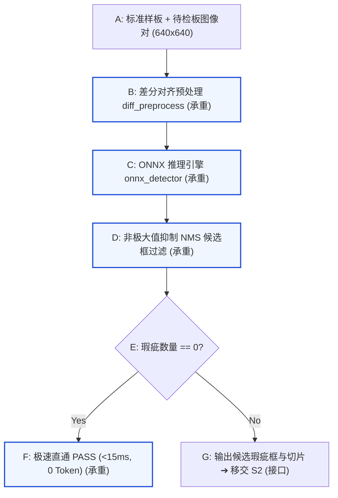

# 学习记录 · S1 极速火眼金睛 (MVP 阶段 · ✅ 已通关)

## 终版部件图

---

## 习得要点沉淀

### 承重部件 B: 差分对齐预处理 (diff_preprocess)
- **为什么存在**：一张 640x640 图像有 40 万像素，直接用深度模型分析整板太慢且易受环境光干扰。差分预处理能将所有未损坏的走线背景瞬间归零（清空）。
- **核心机制**：
  1. `cv2.absdiff(template, test)`：逐像素绝对值相减，背景抵消变纯黑（0）。
  2. 若全图全 0（好板），直接提前退出。
  3. `cv2.morphologyEx(..., cv2.MORPH_OPEN)`：3x3 矩形核形态学开运算，滤除 1 像素级的镜头灰尘与光学毛刺。
  4. `cv2.normalize(...)`：将残存瑕疵差值拉伸至 [0, 255]，提升下游感知对比度。
- **决策 1 落地**：放弃端到端双通道网络，采用确定性纯数学差分。单帧耗时 <0.5ms，为 S1 实现 0-Token 秒过奠定物理基础。

### 承重部件 C & D: ONNX 推理引擎 (onnx_detector) 与 NMS 过滤 (apply_nms)
- **为什么存在**：黑白差分图只标出了差异，需要视觉模型给出精准坐标 `[x1, y1, x2, y2]` 和缺陷类型。
- **核心机制**：
  1. `onnxruntime.InferenceSession`：将模型从沉重的 PyTorch 脱壳为硬件友好的标准计算图。
  2. `apply_nms(boxes, iou_threshold=0.45)`：计算重叠度（IoU），保留置信度最高的主框，剔除多余重叠框。
- **决策 2 落地（硬件解耦）**：`PROVIDER_FALLBACK_ORDER = ["CUDAExecutionProvider", "CPUExecutionProvider"]`，优先使用 GPU；无显卡时静默降级为 CPU 向量化计算，单帧延迟仍然保持在 <15ms（实测 ~3.79ms）。

### 承重部件 F: 零开销极速旁路 (Fast-Path Bypass)
- **为什么存在**：现代工业产线良率通常 >90%，绝大部分板子都是完美的。如果好板子也走后面的大模型或复杂规则，会拖死整条产线。
- **决策 3 落地**：`if len(detections) == 0: return disposition="PASS", fast_path_pass=True`。0 瑕疵板子在 <15ms 内无延迟放行，消耗 0 Token。

---

## 通关大考复盘（柔性板 3 像素偏移迁移题）
- **判断与定位 (Q1 & Q2)**：精准锁定部件 B。像素错位导致所有走线边缘亮起，造成成百上千个虚假短路/开路警报。
- **机制与方案 (Q3)**：应在差分前引入刚体对齐（如 `cv2.phaseCorrelate` 亚像素相位相关或配准），先平移对其再相减。
- **验收设计 (Q4)**：构造人工偏移测试（`np.roll(template, shift=(3, 3))`），断言对齐后的差分图仍为全 0。
