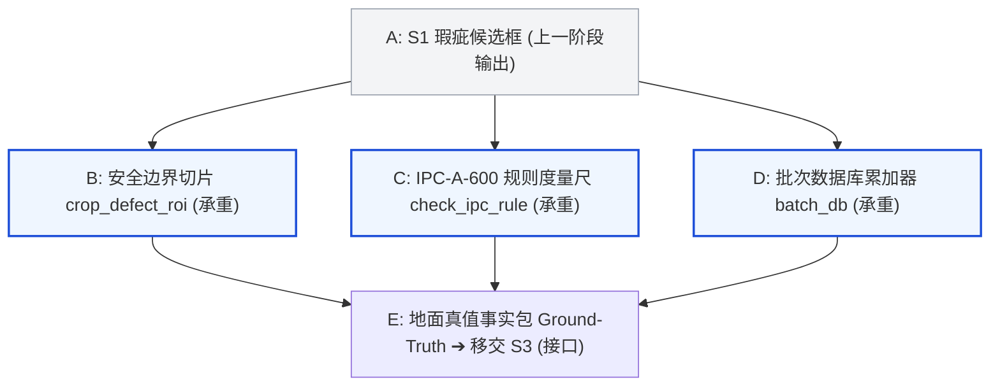

# 学习记录 · S2 工业标准度量尺 (施工中)

## 施工态区（活区 · 部件图真源）

### 1. 数据流图

### 2. 决策层挂牌（只挂问题，拍板后回填）
- **决策 1（行业标准底线）**：开路（Open）和短路（Short）不管面积多小，能不能允许任何像素公差？（到部件 C 时你拍）
- **决策 2（切片视野裕量）**：把瑕疵切出来给人或模型复核时，周边留白留多大才既不越界又能看清走线？（到部件 B 时你拍）
- **决策 3（事实与推理权属）**：国际标准的合规判定，该让大模型阅读标准后自行裁定，还是由 Python 查表强行卡死？（到部件 C 时你拍）

---

## 习得记录区（过关后沉淀）
*(等待 S2 完工与通关大考后沉淀)*
